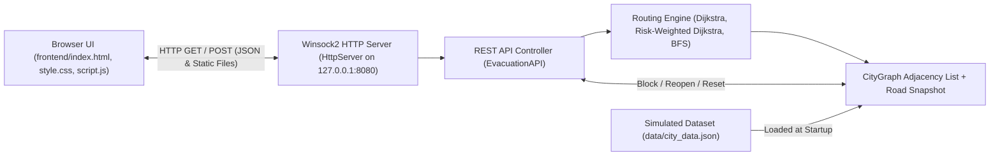

# Intelligent Disaster Evacuation Route Planner

An algorithmic emergency evacuation routing system built in **C++14** with an interactive web-based GIS dashboard. Developed as an individual 3rd-semester B.Tech CSE project for **Advanced Data Structures & Algorithms (ADSA)**, the application models an urban road network as a weighted graph and computes shortest, safety-weighted, and reachability-aware evacuation paths in real time over simulated city data.

---

## 1. Introduction

During urban emergencies such as floods, fires, or sudden road closures, standard shortest-path navigation can route evacuees directly through high-hazard corridors or toward cut-off destinations.

This project addresses that problem by separating physical distance from qualitative corridor hazard penalties (`Low`, `Medium`, `High`), supporting dynamic road blocking and reopening, and exposing a C++ graph engine through a local HTTP server to an interactive browser-based SVG map.

> **Disclaimer:** All locations, road networks, travel speeds, and hazard conditions in this project are simulated for academic demonstration. It is not a certified emergency dispatch system.

---

## 2. Project Screenshots

When launched locally at `http://localhost:8080`, the web dashboard renders:


- **Top Navigation Bar:** Engine connection telemetry, Light/Dark theme toggle, and network reset button.
- **Route Controls & Solver Telemetry (Left Panel):** Origin and shelter selectors, `Safest Route` / `Shortest Route` strategy toggle, hazard weight slider (`0.5x`–`6.0x`), BFS trigger, and live time/space complexity & composite cost readout.
- **Interactive City Network Map (Center):** Vector SVG road topology over a stylized city backdrop with color-coded corridor risk levels, blocked road badges, haloed sector labels, and click-to-select/click-to-block controls.
- **Road Management Table (Center Bottom):** Searchable and filterable table (`All`, `Blocked`, `High Risk`) with per-corridor `Block` / `Reopen` controls.
- **Route Information & BFS Reachability (Right Panel):** Distance (`km`), estimated travel time (`min`), hazard score, hops, turn-by-turn navigation steps, and BFS discovery sequence.

---

## 3. Key Features

- **Interactive City Road Network:** Displays 17 city locations and 26 bidirectional roads on a responsive SVG canvas with Light and Dark modes, toggleable distance/closure badges, and click-to-interact nodes and edges.
- **Shortest Route Optimization:** Uses Dijkstra's algorithm to find the minimum physical distance (`km`) path while skipping blocked roads.
- **Safest Route Optimization:** Evaluates a composite cost combining distance and hazard penalty scaled by a user-adjustable safety multiplier (`0.5x` to `6.0x`), while reporting actual physical distance and cumulative hazard score separately.
- **Dynamic Road Blocking & Reopening:** Blocks or reopens any corridor on the map or in the management table and automatically recalculates the active route.
- **BFS Reachability Exploration:** Runs Breadth-First Search from the selected origin to list level-order reachable locations and flag isolated sectors.
- **Multiple Emergency Shelters:** Includes three fortified evacuation shelters (`Emergency Shelter A`, `Emergency Shelter B`, `Emergency Shelter C`) with capacity metadata.
- **Route Telemetry & Travel Time:** Computes estimated travel time using the configured city average speed (`30.0 km/h`), safety grade classification, and segment-by-segment navigation instructions.

---

## 4. Algorithms and Data Structures

All core graph structures and algorithms are implemented directly in C++ STL (`backend/Graph.h`, `backend/Graph.cpp`, `backend/Algorithms.h`, `backend/Algorithms.cpp`):

| Component | Implementation | Purpose & Behavior | Time Complexity | Space Complexity |
| :--- | :--- | :--- | :--- | :--- |
| **Graph Representation** | Adjacency List (`std::vector<std::vector<Edge>>`) | Stores bidirectional city roads with distance, risk penalty, and blockage flag, paired with `std::unordered_map` lookups and an immutable road snapshot for reset. | $O(V + E)$ | $O(V + E)$ |
| **Priority Queue** | Min-Heap (`std::priority_queue` with `std::greater`) | Extracts the next lowest-cost unsettled vertex during Dijkstra relaxation. | $O(\log V)$ per push/pop | $O(V)$ |
| **Shortest Route** | `EvacuationAlgorithms::findShortestRoute` | Runs Dijkstra minimizing physical distance (`edge.distance`), skipping any edge where `edge.is_blocked` is true, and reconstructs the route via parent pointers. | $O((V + E)\log V)$ | $O(V + E)$ |
| **Risk-Aware Routing** | `EvacuationAlgorithms::findSafestRoute` | Runs Dijkstra minimizing composite edge cost $\text{Distance} + (\text{Risk Penalty} \times W_{\text{risk}})$, where `Low = 1`, `Medium = 3`, `High = 6`. Tracks distance and risk separately. | $O((V + E)\log V)$ | $O(V + E)$ |
| **Reachability Exploration** | `EvacuationAlgorithms::runBFS` (`std::queue<int>`) | Traverses unblocked corridors level-by-level from a chosen origin to compute reachable vs. unreachable sectors. | $O(V + E)$ | $O(V)$ |
| **Dynamic Updates** | `CityGraph::blockRoad` / `reopenRoad` | Updates blockage status across both directions of an edge in the adjacency list and road table. | $O(\deg(u) + \deg(v))$ | $O(1)$ |

---

## 5. Technology Stack

| Layer | Technology | Details |
| :--- | :--- | :--- |
| **Backend Engine** | C++14 (MinGW GCC) | Statically linked binary (`-static -static-libgcc -static-libstdc++`) with standard STL containers. |
| **HTTP Server** | Custom Winsock2 Server (`ws2_32`) | Lightweight multithreaded Windows socket HTTP server (`backend/HttpServer.h`, `backend/HttpServer.cpp`) serving static files and JSON routes on `127.0.0.1:8080`. |
| **JSON Parsing** | `nlohmann/json` (`v3.11.2`) | Single-header JSON library located at `backend/include/json.hpp`. |
| **Frontend UI** | HTML5, CSS3, Vanilla JavaScript | Responsive 3-column workstation layout in `frontend/` with Light/Dark theme persistence (`localStorage`). |
| **Map Visualization** | Native Inline SVG | Interactive map (`viewBox="0 0 1000 680"`) with cartographic backdrop layers, vector sector icons, and route casing highlights. |
| **Data Storage** | Static JSON Dataset | `data/city_data.json` containing 17 locations, 26 roads, risk penalty weights, and average speed metadata. |

---

## 6. System Architecture

The C++ executable loads `data/city_data.json` into `CityGraph` at startup, mounts `frontend/` at `/`, and handles REST-style JSON requests via `EvacuationAPI` over Winsock2.



### Implemented HTTP Endpoints

| Method | Endpoint | Purpose | Request Body |
| :--- | :--- | :--- | :--- |
| `GET` | `/api/network` | Full city graph (locations, roads, metadata) | — |
| `GET` | `/api/locations` | List of all 17 locations | — |
| `GET` | `/api/roads` | List of all 26 roads and blockage status | — |
| `POST` | `/api/route/shortest` | Shortest-distance Dijkstra route | `{"source": 0, "destination": 14}` |
| `POST` | `/api/route/safest` | Risk-weighted Dijkstra route | `{"source": 3, "destination": 8, "risk_weight": 2.0}` |
| `POST` | `/api/bfs` | BFS reachability traversal from source | `{"source": 0}` |
| `POST` | `/api/roads/block` | Mark a road as blocked | `{"road_id": "R01"}` |
| `POST` | `/api/roads/reopen` | Reopen a blocked road | `{"road_id": "R01"}` |
| `POST` | `/api/reset` | Restore baseline network state | `{}` |

---

## 7. Project Structure

```text
ADSA/
├── backend/
│   ├── include/json.hpp         # nlohmann/json v3.11.2 single-header library
│   ├── Graph.h / Graph.cpp      # Adjacency list graph, JSON loader, dynamic mutations
│   ├── Algorithms.h / .cpp      # Shortest Dijkstra, Safest Dijkstra, and BFS implementations
│   ├── HttpServer.h / .cpp      # Lightweight Winsock2 HTTP server
│   ├── api.h / api.cpp          # HTTP endpoint handlers
│   └── main.cpp                 # Entry point, relative path resolution, port listener
├── frontend/
│   ├── index.html               # Dashboard layout and SVG city map structure
│   ├── style.css                # Light/Dark GIS theme and component styles
│   └── script.js                # API integration, SVG rendering, theme & table controllers
├── data/
│   └── city_data.json           # Simulated network (17 locations, 26 roads, 3 shelters)
├── tests/
│   └── algorithm_tests.cpp      # 8 C++ unit tests covering routing, BFS, blocking, and reset
├── bin/                         # Compiled executables (generated by build.bat; gitignored)
├── release/                     # Ready-to-distribute standalone Windows package
│   ├── START.bat
│   ├── README.md
│   ├── SHA256SUMS.txt
│   ├── bin/evac_server.exe
│   ├── data/city_data.json
│   └── frontend/
├── START.bat                    # Standalone Windows launcher (checks files, port 8080, readiness)
├── build.bat                    # Compiles static C++ backend/tests and runs unit tests
├── run.bat                      # Developer launcher (auto-builds if binary missing)
├── .gitignore                   # Ignores compiled binaries and IDE/OS cache files
└── README.md                    # Main project documentation
```

---

## 8. Installation and Execution (From Source)

### Prerequisites
- Windows 10 or Windows 11
- MinGW / MinGW-w64 (`g++` supporting C++14 or newer) configured on Windows `PATH`
- Git Bash (optional) or Command Prompt / PowerShell

### Build and Run

1. **Clone the repository**
   ```bash
   git clone https://github.com/aaryan20-sus/disaster-evacuation-route-planner.git
   cd disaster-evacuation-route-planner
   ```

2. **Compile backend & run C++ unit tests**
   - In Command Prompt / PowerShell:
     ```cmd
     build.bat
     ```
   - In Git Bash:
     ```bash
     cmd.exe /c build.bat
     ```
   `build.bat` compiles `bin/algorithm_tests.exe` and `bin/evac_server.exe` with `-static -static-libgcc -static-libstdc++ -lws2_32` and executes the 8 algorithm verification tests.

3. **Launch the application**
   - Double-click **`START.bat`** in File Explorer, **or** run from terminal:
     - Command Prompt: `START.bat` (or `run.bat` for auto-build dev launch)
     - Git Bash: `cmd.exe /c START.bat`
   - Or run the backend executable directly:
     ```bash
     ./bin/evac_server.exe 8080
     ```
     Then open `http://localhost:8080` in your browser.

---

## 9. Download Standalone Windows Version

Ordinary Windows users **do not need Git Bash, Command Prompt commands, or a C++ compiler (GCC/MinGW)**.

Download the prebuilt release archive directly from GitHub Releases:
**[Download Release v1.0.0](https://github.com/aaryan20-sus/disaster-evacuation-route-planner/releases/tag/v1.0.0)**

1. Download the release ZIP file from the **v1.0.0** release page.
2. Extract the entire ZIP archive to any folder on your computer.
3. Open the extracted folder.
4. Double-click **`START.bat`**.
5. Wait a moment for the backend readiness check to pass and your default browser to open `http://localhost:8080` automatically.
6. Keep the `START.bat` console window open while using the planner; press `Ctrl+C` or close the window when finished.

> **Note on Managed / University Computers:** `bin/evac_server.exe` is currently unsigned (`NotSigned`). Organization-managed PCs with strict **Windows Device Guard (WDAC)** or **AppLocker** policies may block unapproved executables. See [`release/README.md`](release/README.md) and [`release/SHA256SUMS.txt`](release/SHA256SUMS.txt) for SHA-256 verification and IT approval instructions.

---

## 10. Testing and Validation

### C++ Unit Suite (`tests/algorithm_tests.cpp`)
Executing `build.bat` builds and passes **8 / 8** test cases in `bin/algorithm_tests.exe`:
- Shortest Dijkstra route calculation (`City Hospital -> Emergency Shelter A`: `5.1 km`)
- Safest Dijkstra avoiding high-risk shortcut (`Central Park -> Market`: `4.7 km` vs `1.5 km` high-risk shortcut)
- Dynamic road blocking detour (`R01` blocked -> `9.3 km`) and reopening restoration (`5.1 km`)
- BFS reachability traversal (`17` locations reached)
- Disconnected shelter detection (`R13` + `R14` blocked), invalid ID handling, and full network reset recovery

### Automated Release Verification (`verify_release.py`)
The standalone `release/` package passed **12 / 12** automated checks (run from an isolated temporary path containing spaces, with MinGW/GCC stripped from `PATH`):

| # | Check | Verified Result |
| :--- | :--- | :--- |
| 1 | `ABS_PATH_SCAN_OK` | No user-specific or MinGW absolute paths in source, scripts, or `release/` |
| 2 | `MISSING_EXE_ERROR_HANDLING_OK` | `START.bat` exits non-zero with a clear `[ERROR]` if `evac_server.exe` is missing |
| 3 | `PORTABLE_START_BAT_LAUNCH_OK` | Launches from an external folder containing spaces (`System32` CWD, no MinGW in `PATH`) |
| 4 | `FRONTEND_ASSETS_OK` | `/`, `/style.css`, and `/script.js` served with HTTP `200` |
| 5 | `API_NETWORK_OK` | `GET /api/network` returns `17` locations and `26` roads |
| 6 | `DIJKSTRA_SHORTEST_OK` | `POST /api/route/shortest` (`0 -> 14`) returns `5.1 km` |
| 7 | `DIJKSTRA_SAFEST_OK` | `POST /api/route/safest` (`3 -> 8`, weight `2.0`) returns `4.7 km`, risk `2` |
| 8 | `PORT_OCCUPIED_CHECK_OK` | Duplicate `START.bat` detects busy port `8080` and exits cleanly |
| 9 | `BFS_OK` | `POST /api/bfs` reaches `17` locations |
| 10 | `BLOCK_REOPEN_OK` | Blocking `R01` produces `9.3 km` detour; reopening restores `5.1 km` |
| 11 | `RESET_NETWORK_OK` | `POST /api/reset` restores shelter reachability after blocking `R13` and `R14` |
| 12 | `IMMEDIATE_EXIT_DIAGNOSTIC_OK` | Immediate server failure prints Device Guard / startup diagnostic guidance |

*Scope note:* End-to-end automated checks exercised the HTTP endpoints and batch launcher directly via Python `urllib.request`; interactive browser UI clicks and literal OS Device Guard group-policy triggers (`1260`/`4551`) were not emulated in the automated script.

---

## 11. Limitations

- **Simulated Dataset:** All city locations, coordinates, distances, risk categories, and `30.0 km/h` average speed come from `data/city_data.json` and do not reflect real-world geography or live incidents.
- **Not Certified for Real Emergencies:** This software is an educational ADSA project and must not be used for real-world emergency dispatch or life-safety routing, which requires verified GIS road data, live traffic/hazard feeds, and authoritative shelter status.
- **Windows / Localhost Only:** `HttpServer` uses Windows Winsock2 (`ws2_32`) on `127.0.0.1:8080` and is intended for single-user local execution on Windows 10/11.
- **Unsigned Binary:** Release builds are not Authenticode-signed, so SmartScreen prompts on personal PCs or Device Guard blocks on managed institutional computers can occur.

---

## 12. Future Enhancements

- **Real-Time Traffic Integration:** Incorporate live road speed and congestion multipliers into edge weights.
- **Live Fire and Flood Alerts:** Dynamically ingest external disaster feeds to escalate edge risk penalties or trigger automatic road closures.
- **GPS-Based Location:** Detect the user's current coordinates to automatically select the nearest graph sector.
- **Real-World Map Integration:** Replace or back the simulated Cartesian coordinates with real road networks and tile maps.
- **Sensor-Based Hazard Detection:** Connect IoT water-level, smoke, or structural sensors directly to road risk status updates.

---

## 13. License and Project Information

- **Course Context:** Advanced Data Structures & Algorithms (ADSA) — 3rd Semester B.Tech CSE Individual Project
- **Repository:** [disaster-evacuation-route-planner](https://github.com/aaryan20-sus/disaster-evacuation-route-planner)
- **License Status:** No `LICENSE` file is currently included in this repository. All rights remain with the project author unless a formal license is added later.
